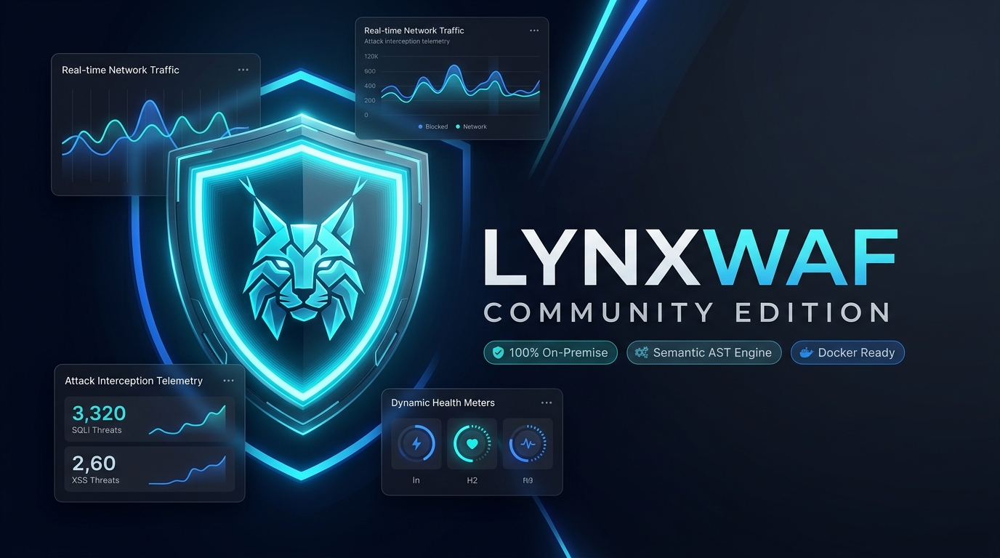

<p align="center">
  
</p>

<h1 align="center">LynxWAF Community Edition (CE)</h1>

<p align="center">
  <strong>Next-Gen Sovereign Web Application Firewall & Semantic L7 Attack Defense Engine</strong>
</p>

<p align="center">
  <a href="https://github.com/ones006/LynxWAF-CE/releases"></a>
  <a href="LICENSE"></a>
  
  
  <a href="https://t.me/onelynxs"></a>
</p>

<p align="center">
  <a href="#-quick-start-1-line-installation">Quick Start</a> •
  <a href="#-key-features">Key Features</a> •
  <a href="#-homelab--small-business-hardware-appliance">Homelab & Raspberry Pi</a> •
  <a href="#-feature-matrix-ce-vs-sovereign-edition">CE vs Sovereign Edition</a> •
  <a href="#-system-requirements">Requirements</a> •
  <a href="#-attack-simulation--testing">Testing & PoC</a> •
  <a href="docs/QUICKSTART.md">Documentation</a> •
  <a href="https://t.me/onelynxs">Telegram Support</a>
</p>

---

## 📖 Overview

**LynxWAF Community Edition (CE)** is an ultra-fast, modern, and unencumbered Web Application Firewall (WAF) designed to protect websites, APIs, and microservices against OWASP Top 10 vulnerabilities, automated bot floods, and zero-day exploits.

Built on an optimized **OpenResty / LuaJIT** data plane and a **compiled Go** control plane with a cyber-SOC single-page management console, LynxWAF delivers enterprise-grade protection with zero cloud dependencies and **100% on-premise data sovereignty**.

### Why Choose LynxWAF CE?
- 🛡️ **Semantic AST Analysis**: Evaluates Abstract Syntax Trees rather than brittle regular expressions, defeating evasion techniques like comment injection, encoding variations, and nested payloads.
- ⚡ **High Throughput & Low Latency**: Sub-millisecond inspection latency powered by LuaJIT and connection-pooling reverse proxy.
- 🔒 **Zero Telemetry Guarantee**: Runs 100% on your own infrastructure. No logs, traffic metrics, or SSL keys are ever phoned home to external cloud providers.
- 🤖 **Silent Anti-Bot Defense**: Invisible computational Proof-of-Work (PoW) challenge that mitigates scrapers and brute-force bots without disrupting human visitors with CAPTCHAs.
- 🍓 **Native ARM64 & Raspberry Pi Ready**: Lightweight footprint (~300MB idle RAM) running natively on **Raspberry Pi 4 / 5, Orange Pi, Rockchip, Intel NUC, and Homelab SBC mini-PCs**. Perfect for home labs, self-hosted services, and small business on-premise appliances.
- 🐳 **Hardened CIS Container Stack**: Non-root execution (`uid 1000`), read-only root filesystems, and `cap_drop: ALL`.

---

## ⚡ Quick Start: 1-Line Installation

Deploy LynxWAF Community Edition on any Linux VPS or dedicated server in under 2 minutes:

```bash
bash -c "$(curl -fsSL https://raw.githubusercontent.com/ones006/LynxWAF-CE/main/install.sh)"
```

### What happens automatically:
1. Validates system memory and hardware architecture (`amd64` / `arm64`).
2. Installs Docker and Docker Compose v2 if not already present.
3. Generates cryptographically secure, random 24-character secrets in `.env`.
4. Pulls official container images and launches the stack with `docker compose up -d`.
5. Provisions the initial `admin` account and outputs your Web Console URL!

> **Web Console Access:**  
> Navigate to `https://<YOUR_SERVER_IP>:8379/<SECURITY_ENTRANCE>`  
> *(Default Username: `admin` | Password & Security Entrance: displayed upon script completion)*

---

## 🛠️ Manual Deployment via Docker Compose

If you prefer full control over repository files and environment variables:

```bash
# 1. Clone this repository
git clone https://github.com/ones006/LynxWAF-CE.git /opt/lynxwaf
cd /opt/lynxwaf

# 2. Copy the sample environment configuration
cp .env.example .env

# 3. Create required runtime directories
mkdir -p config data/mysql/data data/mysql/log data/nginx/logs data/nginx/conf data/nginx/conf.d data/wwwroot logs

# 4. Start the container stack
docker compose up -d

# 5. Create your administrator account
docker exec -it lynxwaf-daemon /app/LynxWaf create_default_user admin "YourSecurePassword123!"

# 6. Configure Security Entrance (admin URL safe path)
docker exec -it lynxwaf-daemon /app/LynxWaf set_auth_path "mysecretpath"
```

---

## ✨ Key Features

| Feature | Description |
| :--- | :--- |
| **Semantic L7 Inspection** | Real-time AST parsing for SQLi, XSS, RCE, Path Traversal, and SSRF attacks. |
| **OWASP CRS v4 Compatibility** | Industry-standard protection rules tailored for modern web applications and REST APIs. |
| **Silent Anti-Bot PoW** | Frictionless cryptographic client challenge defeating headless browsers, scrapers, and credential stuffers. |
| **Automated Let's Encrypt** | Embedded ACME client for automated issuance and seamless zero-downtime certificate renewal. |
| **Custom SSL/TLS Support** | Upload custom enterprise or wildcard certificates with instant Lua hot-reload. |
| **Real-Time SOC Console** | Modern Vue 3 dashboard displaying threat attack graphs, live logs, and interception telemetry. |
| **CC / Rate Limiting** | Sliding window rate limits stored in Redis to protect origin APIs against Layer 7 denial of service. |
| **CIS Docker Hardening** | Unprivileged non-root containers, drop-all Linux capabilities, and immutable read-only filesystems. |

---

## 📊 Feature Matrix: CE vs Sovereign Edition

LynxWAF Community Edition is **Free Forever** for 1 protected root domain (unlimited subdomains) on a single standalone node. Need more? **Professional Edition** covers 15 root domains at Rp 1.500.000 / node / month, and **Sovereign Edition** unlocks unlimited domains plus the full enterprise stack:

| Capability | Community Edition (CE) | Sovereign Edition |
| :--- | :---: | :---: |
| **License Cost** | **Free Forever (Rp 0 / $0)** | Subscription OPEX / Perpetual CAPEX |
| **Protected Domains** | **1 Root Domain** | 15 (Professional) to Unlimited (Sovereign) |
| **Node Cluster Nodes** | **1 Standalone Node** | Multi-Node Active-Active HA Cluster |
| **Semantic AST L7 Inspection** | Included | Included |
| **Silent PoW Anti-Bot Defense** | Included | Included |
| **Automated Let's Encrypt SSL** | Included | Included |
| **Real-time SOC Threat Dashboard** | Included | Included + SIEM / Syslog RFC 5424 Export |
| **Kernel eBPF / XDP Anti-DDoS** | — | Included (Wire-Speed <100ns Packet Drop) |
| **Isolated On-Premise AI Guardrails** | — | Included (Local LLM Prompt-Injection Defense) |
| **Outbound DLP (UU PDP No. 27/2022)** | — | Included (Automatic NIK / Credit Card Masking) |
| **Compliance PDF Generator** | — | Included (PCI-DSS v4.0, ISO 27001, SOC 2 Reports) |
| **White-Labeling & Custom Branding** | — | Included (Reseller / MSP Ready) |
| **Multi-Tenant MSP Portal** | — | Included (Sub-Organizations & Scope Isolation) |
| **Support SLA** | GitHub Issues & Community | 24/7 Dedicated Support SLA & Phone Hotline |

---

## 🧪 Attack Simulation & Testing

Verify that your LynxWAF deployment is actively blocking malicious traffic with our included PoC test suite:

```bash
cd /opt/lynxwaf
./test_poc_simulation.sh https://<YOUR_PROTECTED_DOMAIN_OR_IP>
```

The script executes real-world attack vectors (SQLi, XSS, RCE, Path Traversal, Scanner Probes) and verifies that LynxWAF responds with an immediate **`403 Forbidden`** interception response.

---

## 🍓 Homelab & Small Business Hardware Appliance

LynxWAF is engineered with high-efficiency compiled Go and C/LuaJIT routines, making it exceptionally lightweight and suitable for running on cost-effective Single Board Computers (SBC) and low-power hardware:

```
                      LynxWAF Edge Security Gateway
             ┌──────────────────────────────────────────────┐
             │   Raspberry Pi 4 / 5  or  Mini-PC / NUC      │
             │                                              │
Internet ───►│ [Port 80/443: LynxWAF L7 Semantic Inspection]├──► Internal LAN /
             │ [Port 8379: Cyber-SOC Management Console]   │    Home Assistant,
             └──────────────────────────────────────────────┘    Nextcloud, ERP
```

| Target Device | Tested Architecture | Idle RAM Footprint | Ideal Use Case |
| :--- | :--- | :---: | :--- |
| **Raspberry Pi 5 (4GB / 8GB)** | `linux/arm64` | ~300 MB | High-traffic self-hosted websites, home labs, remote branch offices |
| **Raspberry Pi 4 Model B (2GB+)** | `linux/arm64` | ~300 MB | Home lab edge firewall, Nextcloud / Home Assistant security proxy |
| **Orange Pi 5 / Rock 5B** | `linux/arm64` | ~320 MB | Gigabit throughput inspection for local servers |
| **Intel NUC / Beelink / Chuwi Mini-PC** | `linux/amd64` | ~350 MB | Small & Medium Enterprise (SME) on-premise security appliance |
| **Proxmox VE / KVM / ESXi VM** | `amd64` / `arm64` | ~400 MB | Virtualized edge security gateway |

> **💡 Homelab Tip:**  
> By placing LynxWAF on a Raspberry Pi or Mini-PC at your home network boundary, you can safely expose self-hosted services (Home Assistant, Nextcloud, Plex, Portainer, Vaultwarden, local web servers) to the internet while maintaining full protection against brute-force bots, SQL injections, and zero-day scanner exploits!

---

## 💻 System Requirements

- **Operating System**: Linux (Ubuntu 20.04+, Debian 11+, CentOS 7+, Rocky/AlmaLinux 8+, Alpine, Arch Linux)
- **Architecture**: `x86_64` (`amd64`) or `aarch64` (`arm64`)
- **Memory**: Minimum 1 GB RAM (2 GB+ recommended for production)
- **Disk**: 5 GB+ free storage
- **Container Engine**: Docker >= 20.10 & Docker Compose v2
- **Required Ports**:
  - `80/tcp`: HTTP reverse proxy & ACME certificate validation
  - `443/tcp`: HTTPS reverse proxy
  - `8379/tcp`: LynxWAF Cyber-SOC Management Console

---

## 📋 Management Commands

All operations can be performed using standard Docker Compose commands from your installation directory (`/opt/lynxwaf`):

```bash
# Check service status
docker compose ps

# View live proxy & attack interception logs
docker compose logs -f lynxwaf-openresty

# View management daemon logs
docker compose logs -f lynxwaf-daemon

# Restart the entire defense stack
docker compose restart

# Reset lost administrator password
docker exec -it lynxwaf-daemon /app/LynxWaf reset_password "NewStrongPassword123!"

# Update to latest Community Edition release
sudo bash update.sh

# Preview an update without changing anything
sudo bash update.sh --dry-run
```

> `update.sh` records the running image digests in `logs/`, backs up `config/` and
> `data/nginx/` into `backups/`, then validates the stack and prints the root-domain
> allowance it is now running under. Rollback and flags: [docs/UPGRADE_GUIDE.md](docs/UPGRADE_GUIDE.md).

---

## 🚀 Kernel-Level L4 Defense (eBPF / XDP) — Opt-In

The default stack runs the management daemon unprivileged with every capability
dropped, which is the safe default but cannot attach an XDP program to a NIC. In that
mode the *Network Defense (L4)* console reports the datapath as unavailable and stores
your settings as policy only — it never reports drops it did not make.

To run the kernel datapath for real, generate the overlay on the server and start the
daemon with it. It is deliberately **not a file in this repository**: it grants uid 0,
`CAP_BPF`/`CAP_NET_ADMIN`/`CAP_SYS_ADMIN` and the host network namespace, so nothing
privileged lands on your machine through an installer, an update or a clone. The shipped
image produces its own overlay, which keeps the text and the feature in the same place:

```bash
cd /opt/lynxwaf
docker compose run --rm --no-deps lynxwaf-daemon ebpf --overlay > docker-compose.ebpf.yml
chmod 600 docker-compose.ebpf.yml
sudo docker compose -f docker-compose.yml -f docker-compose.ebpf.yml up -d --force-recreate lynxwaf-daemon
```

The file stays inert until you name it with `-f`. `update.sh` does not refresh it any
more — once it is yours, comparing and replacing it is an operator decision.

The overlay gives the daemon `CAP_BPF` + `CAP_NET_ADMIN` + `CAP_SYS_ADMIN` and host
networking. `SYS_ADMIN` is required by the kernel BPF verifier for pointer arithmetic
inside `xdp_filter.c` (relaxed in kernel 6.7+). That has consequences: the console
listens on port 8379 on **every** interface — `LYNXWAF_BIND_IP` no longer applies, so
filter it yourself — files under `config/`, `logs/`, `data/` and `ssl/` become
root-owned, and XDP drops happen before netfilter. Full list and the manual/air-gapped
variant of the file: [Troubleshooting F](docs/TROUBLESHOOTING.md).

### XDP Attachment Modes

| Mode | Latency | Requirement |
| --- | --- | --- |
| **Generic** (default) | ~200–500 ns | Any Linux kernel ≥ 4.13, any NIC |
| **Native** | < 100 ns | NIC driver must support `.ndo_bpf` (Intel i225/i226/i210/X520/E810, Realtek RTL8125/8168, Mellanox ConnectX-4+, Broadcom BCM5720) |
| **Hardware Offload** | < 20 ns | SmartNIC only: NVIDIA ConnectX-4/5/6/7, Netronome NFP3800/4000, Intel E810-C (kernel ≥ 6.1) |

Start with **Generic**; switch to **Native** if your NIC supports it (check:
`ethtool -i <iface> | grep driver`). Hardware Offload is for 100G+ deployments.
Full NIC compatibility table and verifier details:
[docs/EBPF_XDP_DATAPATH.md §6](https://g.thinkm.id/TangaraMitrakom/LynxWAF/src/main/docs/EBPF_XDP_DATAPATH.md) (main repo).

---

## 🗑️ Uninstalling LynxWAF Community Edition

To completely remove LynxWAF, stop all services, and wipe all local databases and configurations:

```bash
cd /opt/lynxwaf && sudo ./uninstall.sh
```

To purge cached container images from disk as well:
```bash
cd /opt/lynxwaf && sudo ./uninstall.sh --purge-images
```

---

## 🚀 Upgrading to Sovereign Edition

Upgrading from Community Edition to Sovereign Edition requires **zero downtime and no re-installation**:
1. Contact us via Telegram [**@onelynxs**](https://t.me/onelynxs) or email `ones006@gmail.com` to obtain an Ed25519-signed license (`lynxwaf.lic`).
2. Open your LynxWAF Web Console (`https://<IP>:8379`).
3. Navigate to **Settings ➔ License & Cryptography**.
4. Paste your signed `.lic` content and click **Activate**.
5. All Sovereign capabilities (eBPF XDP, AI Guardrails, Outbound DLP, unlimited domains) unlock **instantly in memory without container restarts**!

---

## 📚 Documentation Index

- [Quick Start Guide](docs/QUICKSTART.md) — Step-by-step installation, firewall ports, and initial onboarding.
- [Configuration Guide](docs/CONFIGURATION.md) — Reverse proxy upstreams, SSL certificates, and custom rules.
- [Architecture Deep Dive](docs/ARCHITECTURE.md) — Internal mechanics, request lifecycle, and data flow.
- [Troubleshooting & FAQ](docs/TROUBLESHOOTING.md) — Port conflicts, log diagnosis, and password recovery.
- [Upgrade Guide](docs/UPGRADE_GUIDE.md) — In-place updates and enterprise license migration.

---

## 🤝 Community & Support

- **Telegram Support & Inquiries**: [**@onelynxs**](https://t.me/onelynxs)
- **Bug Reports & Issues**: [GitHub Issues](https://github.com/ones006/LynxWAF-CE/issues)
- **Feature Requests**: [GitHub Discussions](https://github.com/ones006/LynxWAF-CE/discussions)
- **Commercial Licensing & Partnerships**: Telegram [**@onelynxs**](https://t.me/onelynxs) or `ones006@gmail.com`

---

## 📄 License

- Deployment orchestration templates, compose stacks, and documentation are licensed under the **[Apache License 2.0](LICENSE)**.
- LynxWAF Community Edition container binaries are provided **Free Forever** for personal and commercial production use on 1 protected root domain (unlimited subdomains) on 1 standalone node.
- Copyright (c) 2026 LynxWAF Team. All Rights Reserved.
