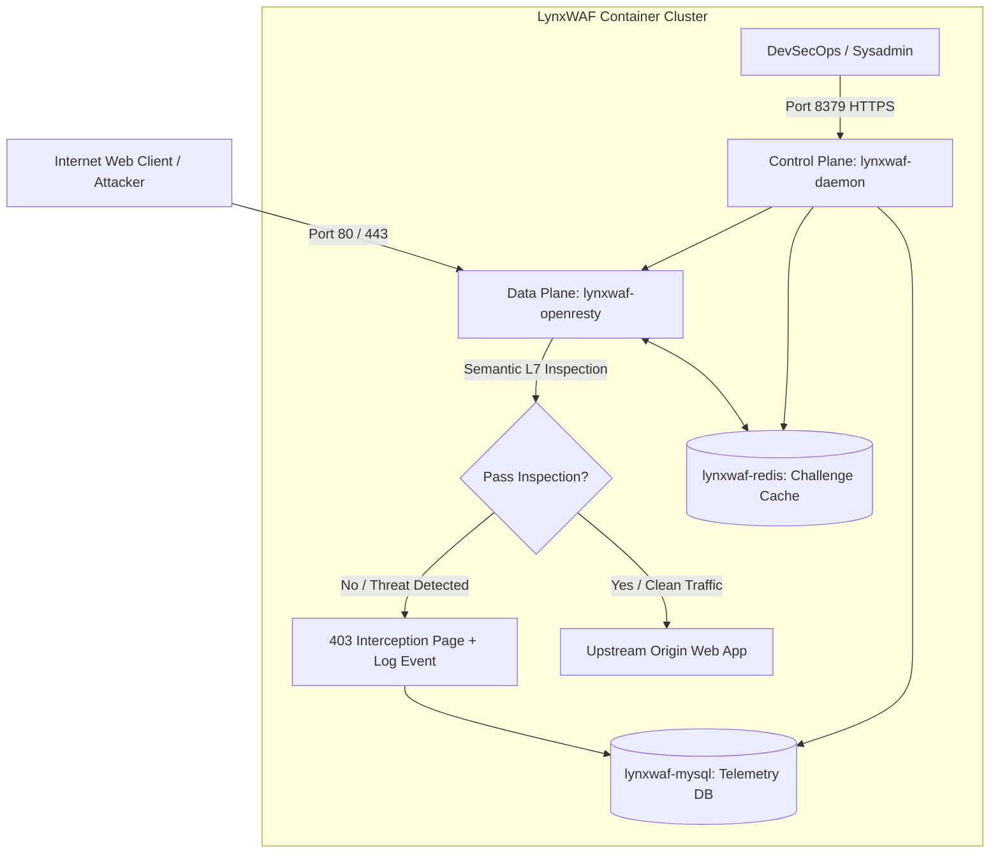

# LynxWAF Community Edition — Technical Architecture

This document describes the internal architecture, container isolation models, and request lifecycle of **LynxWAF Community Edition**.

---

## 1. High-Level Architecture Overview

LynxWAF separates the **Data Plane** (high-throughput traffic inspection proxy) from the **Control Plane** (management API and web dashboard) to ensure optimal speed, reliability, and security.



---

## 2. Core Components

### 1. Data Plane (`lynxwaf-openresty`)
- **Base Technology**: Optimized OpenResty runtime with LuaJIT and Libinjection.
- **Network Mode**: `network_mode: "host"` to eliminate Docker NAT bridge overhead and preserve true client source IPs for accurate rate limiting and geographic analysis.
- **Inspection Logic**: High-speed Lua coroutines running inline during the `access_by_lua` request phase.

### 2. Control Plane (`lynxwaf-daemon`)
- **Base Technology**: Compiled Go binary with an embedded Vue Cyber-SOC Single Page Application.
- **Port**: Bound to port `8379` (configurable via `.env`).
- **Functionality**: Site configuration management, certificate lifecycle, user authentication, rule management, and log aggregation.

### 3. Telemetry Storage (`lynxwaf-mysql`)
- Dedicated MySQL 8.0 instance tuned for write-heavy log ingestion.
- Bound strictly to localhost (`127.0.0.1:33060`) to prevent external exposure.

### 4. Fast Cache & State (`lynxwaf-redis`)
- Redis 7 In-Memory engine handling anti-bot Proof-of-Work seeds, token verification, and per-second IP sliding window rate limit counters.
- Bound strictly to localhost (`127.0.0.1:6379`).

---

## 3. Defense-in-Depth Container Hardening

LynxWAF is engineered following the **CIS Docker Benchmark** and the principle of least privilege:

1. **Non-Root Execution**:
   - Both `lynxwaf-openresty` and `lynxwaf-daemon` execute as unprivileged user `lynxwaf` (UID `1000`, GID `1000`).
2. **Capability Dropping**:
   - `cap_drop: ALL` drops all kernel capabilities.
   - Only strictly necessary capabilities (e.g., `NET_BIND_SERVICE` for ports 80/443) are granted.
3. **Read-Only Root Filesystem**:
   - Container root filesystems are mounted read-only (`read_only: true`).
   - Ephemeral working files are confined to in-memory `tmpfs` mounts with `noexec,nosuid`.
4. **No Privilege Escalation**:
   - `security_opt: - no-new-privileges:true` prevents child processes from acquiring additional privileges.

---

## 4. Request Lifecycle Step-by-Step

```
1. Client establishes TCP connection on port 80 or 443.
2. TLS Termination & SNI routing evaluated by OpenResty.
3. IP Access Control Check (Whitelist ➔ bypass; Blacklist ➔ drop).
4. Silent Anti-Bot Challenge (Evaluates PoW token cookie if challenge enabled).
5. Rate Limiting Check (Evaluates sliding window counters in Redis).
6. L7 Semantic AST Inspection:
   - Request URI & Query parameters
   - Request Headers & User-Agent
   - Request Body (JSON, Multipart form, URL-encoded)
7. Decision:
   - If ANY rule triggers in "Protecting" mode:
     ➔ Execution stops immediately
     ➔ HTTP 403 Forbidden with unique Incident ID returned to client
     ➔ Attack metadata written to Telemetry DB asynchronously
   - If clean:
     ➔ Request forwarded to upstream backend via HTTP keepalive connection
     ➔ Origin response proxied back to client
```

---

## 5. Zero Telemetry & Data Sovereignty Guarantee

LynxWAF Community Edition is **100% self-contained and on-premise**:
- **Zero Cloud Phone-Home**: LynxWAF does not send logs, domains, or traffic telemetry to any external cloud service.
- **Data Sovereignty**: All SSL certificates, encryption keys, and request payload logs remain exclusively on your server.
- **Air-Gapped Ready**: Can operate in fully isolated private networks and dark-site infrastructure.
