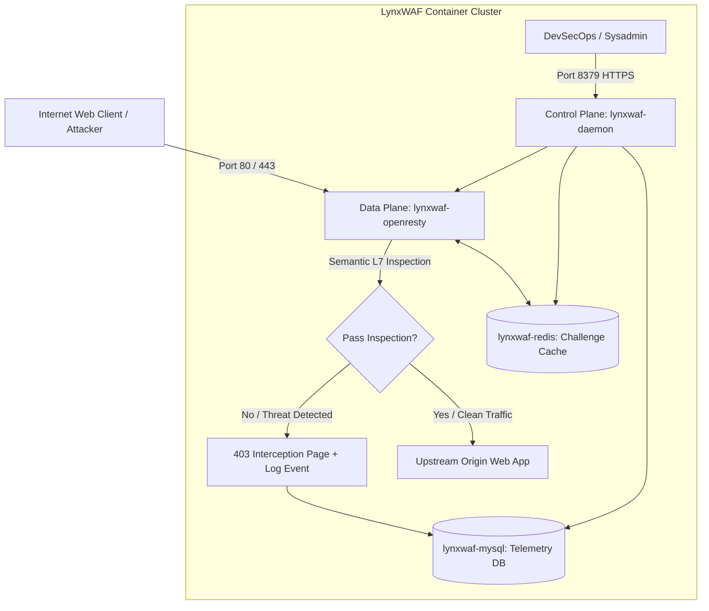

# LynxWAF Community Edition — Technical Architecture

This document describes the internal architecture, container isolation models, and request lifecycle of **LynxWAF Community Edition**.

---

## 1. High-Level Architecture Overview

LynxWAF separates the **Data Plane** (high-throughput traffic inspection proxy) from the **Control Plane** (management API and web dashboard) to ensure optimal speed, reliability, and security.



---

## 2. Core Components

### 1. Data Plane (`lynxwaf-openresty`)
- **Base Technology**: Optimized OpenResty runtime with LuaJIT and Libinjection.
- **Network Mode**: `network_mode: "host"` to eliminate Docker NAT bridge overhead and preserve true client source IPs for accurate rate limiting and geographic analysis.
- **Inspection Logic**: High-speed Lua coroutines running inline during the `access_by_lua` request phase.

### 2. Control Plane (`lynxwaf-daemon`)
- **Base Technology**: Compiled Go binary with an embedded Vue Cyber-SOC Single Page Application.
- **Port**: Bound to port `8379` (configurable via `.env`).
- **Functionality**: Site configuration management, certificate lifecycle, user authentication, rule management, and log aggregation.

### 3. Telemetry Storage (`lynxwaf-mysql`)
- Dedicated MySQL 8.0 instance tuned for write-heavy log ingestion.
- Bound strictly to localhost (`127.0.0.1:33060`) to prevent external exposure.

### 4. Fast Cache & State (`lynxwaf-redis`)
- Redis 7 In-Memory engine handling anti-bot Proof-of-Work seeds, token verification, and per-second IP sliding window rate limit counters.
- Bound strictly to localhost (`127.0.0.1:6379`).

---

## 3. Defense-in-Depth Container Hardening & Privilege Model

LynxWAF applies the principle of least privilege and strict isolation across its container stack:

1. **Control Plane (`lynxwaf-daemon`)**:
   - Executes strictly as unprivileged non-root user `lynxwaf` (UID `1000`, GID `1000`).
   - Drops all Linux kernel capabilities (`cap_drop: ALL`) and retains only `NET_BIND_SERVICE` to bind management port 8379.
   - Enforces `security_opt: - no-new-privileges:true` to block child processes from gaining elevated privileges.
   - External telemetry and outbound connections are disabled by default.

2. **Data Plane (`lynxwaf-openresty`)**:
   - Operates in `network_mode: "host"` to preserve true client source IPs and eliminate Docker bridge NAT overhead.
   - Master process initializes and binds privileged host ports (80/443), then immediately drops privileges to unprivileged worker processes running as user `lynxwaf` (UID `1000`, GID `1000`) for all traffic inspection and reverse proxying.
   - Ephemeral working files and request buffers (`client_body_temp`, `proxy_temp`, `fastcgi_temp`, `uwsgi_temp`, `scgi_temp`, `/tmp`, `/run`) are mounted to in-memory `tmpfs` volumes with `noexec,nosuid` flags, ensuring payload buffers never touch disk.
   - Engine configuration and web root directories are mounted read-only (`:ro`).

3. **Telemetry & State Engines (`lynxwaf-mysql` & `lynxwaf-redis`)**:
   - Isolated strictly to host loopback interfaces (`127.0.0.1:33060` and `127.0.0.1:6379`), preventing WAN-side exposure.
   - Execute with dropped kernel capabilities (`cap_drop: ALL`) keeping only minimum operational capabilities (`SETUID`, `SETGID`, `CHOWN`, `DAC_OVERRIDE`).
   - Enforce `security_opt: - no-new-privileges:true`.

---

## 4. Request Lifecycle Step-by-Step

```
1. Client establishes TCP connection on port 80 or 443.
2. TLS Termination & SNI routing evaluated by OpenResty.
3. IP Access Control Check (Whitelist ➔ bypass; Blacklist ➔ drop).
4. Silent Anti-Bot Challenge (Evaluates PoW token cookie if challenge enabled).
5. Rate Limiting Check (Evaluates sliding window counters in Redis).
6. L7 Semantic AST Inspection:
   - Request URI & Query parameters
   - Request Headers & User-Agent
   - Request Body (JSON, Multipart form, URL-encoded)
7. Decision:
   - If ANY rule triggers in "Protecting" mode:
     ➔ Execution stops immediately
     ➔ HTTP 403 Forbidden with unique Incident ID returned to client
     ➔ Attack metadata written to Telemetry DB asynchronously
   - If clean:
     ➔ Request forwarded to upstream backend via HTTP keepalive connection
     ➔ Origin response proxied back to client
```

---

## 5. Zero Telemetry & Data Sovereignty Guarantee

LynxWAF Community Edition is **100% self-contained and on-premise**:
- **Zero Cloud Phone-Home**: LynxWAF does not send logs, domains, or traffic telemetry to any external cloud service.
- **Data Sovereignty**: All SSL certificates, encryption keys, and request payload logs remain exclusively on your server.
- **Air-Gapped Ready**: Can operate in fully isolated private networks and dark-site infrastructure.

> [!NOTE]
> **What a default install does send.** One request runs without being configured: the
> nightly blocklist refresh, which GETs two public publisher pages (the Tor Project exit
> list and Spamhaus DROP) and reads address ranges back. The GET is unauthenticated and
> carries no licence ID, hostname, domain or customer data. Set
> `LYNXWAF_THREAT_INTEL_SYNC=off` and the schedule skips it — the addresses already
> stored keep their expiry clock, so the blocklist decays instead of being emptied. Point
> `LYNXWAF_FEED_URL` at a signed feed manifest from a mirror you run instead, and that
> fetch becomes the only source. Every other path out is opt-in and off by default:
> licence activation, licence heartbeat, monthly report email, public IP detection,
> update checks, update telemetry and the vulnerability feed. Each one is documented in
> [`.env.example`](../.env.example).
